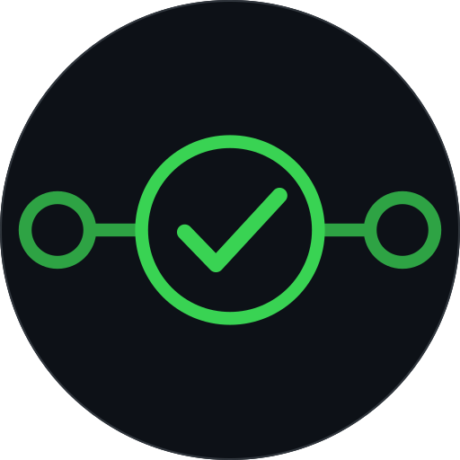
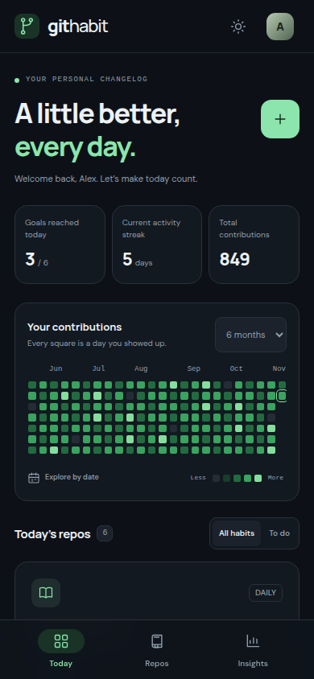
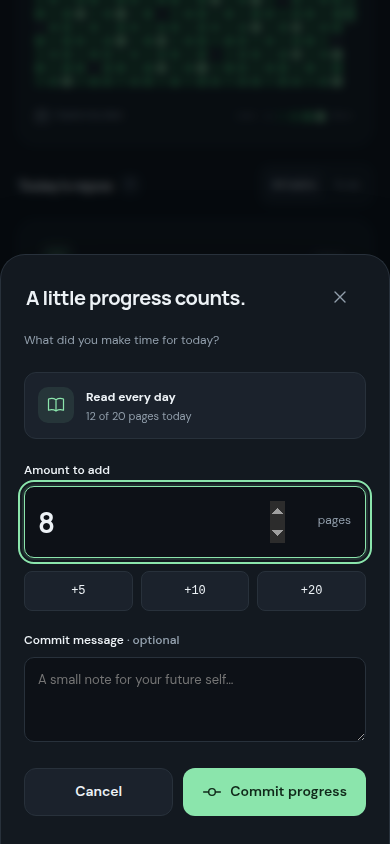
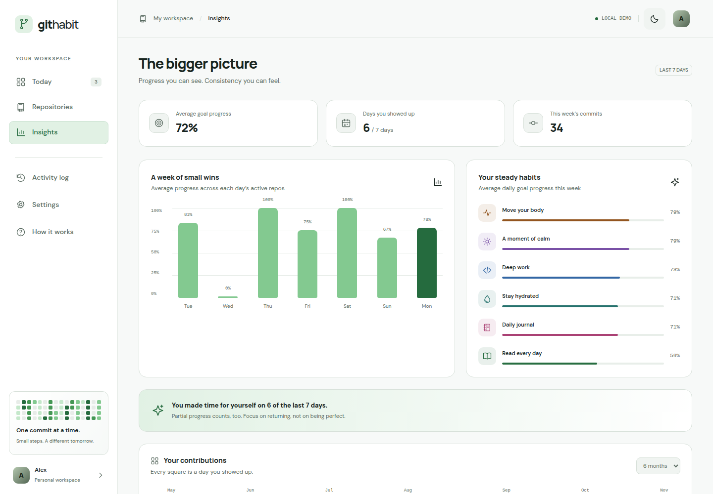
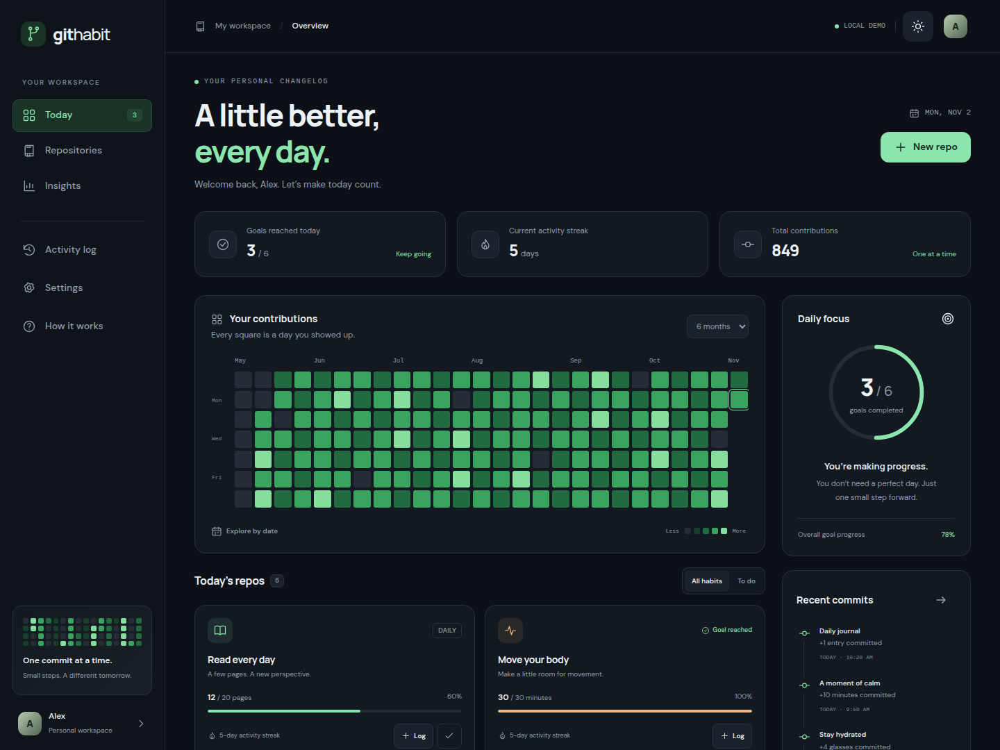

<p align="center">
  
</p>

<h1 align="center">GitHabit</h1>

<p align="center"><strong>A little better, every day.</strong></p>

<p align="center">
  A local-first habit tracker for Android that treats your habits like repos
  and your progress like commits — with a GitHub-style contribution graph
  that shows every day you showed up.
</p>

<p align="center">
  
  
  
  
  
</p>

---

## What is GitHabit?

GitHabit turns habit tracking into something developers already understand:

- **A habit is a repo.** Give it a name, a daily target and a unit — *read 20 pages*, *move 30 minutes*, *drink 2 litres*.
- **Progress is a commit.** Log an amount toward today's target, add an optional note, and watch the graph fill in.
- **Your year is a contribution graph.** Every square is a day you showed up. Streaks count days with any logged progress, not perfection.

No account. No backend. No cloud sync. Your data stays on your phone, in a local workspace you can export, restore, or reset whenever you want.

## Preview

Screenshots use sample data, to show the design.

| Today | Log a commit |
| --- | --- |
|  |  |

| Insights (light theme) | Today (desktop preview) |
| --- | --- |
|  |  |

## Features

- **Today** — log progress in one tap, see what's due, what's left, and your current streak at a glance. *Complete goal* adds only the remaining amount, never another full target.
- **Repos** — search and filter your habits, create and edit them, and pause, archive, or resume any time.
- **Repo detail** — a per-habit heatmap, daily progress, and full history, with editing and deletion of past commits.
- **Schedules that fit real life** — daily, selected weekdays, or *N* target days per calendar week.
- **Insights** — weekly progress, day and week adherence, and per-habit consistency, calculated from your actual logs.
- **Activity** — a chronological log of every commit, with corrections and Undo.
- **Explore by date** — tap any day on the graph for exact amounts, eligibility, and weekly context.
- **Settings** — optional profile, System / Light / Dark theme, week-start day, JSON export, validated restore, and confirmed reset (with an export-first option).
- **Adaptive layout** — bottom navigation on phones, navigation rail and list/detail on larger screens, with saved drafts, scroll positions, and system Back support.

## How tracking works

- A commit adds progress toward that day's target. Amounts can be fractional (up to three decimal places) and can exceed the goal — the daily ratio is capped at 100%.
- **Complete goal** adds only what's still missing.
- Weekly schedules count *distinct days* that reached the daily target, not the number of commits or total quantity.
- Changes to a target, schedule, or status apply from today onward. Earlier days keep the expectations they had.
- Units are locked after the first commit — create a separate repo to track a different unit.
- New commits are for today; older commits can be corrected or deleted.
- An activity streak counts consecutive days with any logged progress. An unfinished today doesn't break yesterday's streak.

## Privacy

- **Local only.** No sign-in, no server, no analytics, no GitHub integration, no reminders or notifications.
- Data lives in app-private storage as versioned JSON. Export and restore use Android's document picker, and exports are plain JSON files — keep them somewhere safe.
- Clearing app data or uninstalling erases the on-device workspace, so export a copy first if it matters to you.

## Get the app

GitHabit is a native Android app, built with **Kotlin, Jetpack Compose, and Material 3**. The full build guide, toolchain versions, and test instructions live in [`android/README.md`](android/README.md).

**Quick build** (Android 8.0 / API 26 or newer):

```bash
cd android
export ANDROID_HOME="$HOME/Android/Sdk"
./gradlew :app:assembleDebug
```

The APK lands at `app/build/outputs/apk/debug/app-debug.apk`. Or open the `android/` folder in Android Studio and press Run.

| Component | Version |
| --- | --- |
| Kotlin / Compose compiler | 2.2.20 |
| Compose BOM | 2025.09.01 |
| Android Gradle Plugin | 8.13.0 |
| Compile / target SDK | 36 |
| Minimum SDK | 26 (Android 8.0) |

## Project structure

| Path | What's there |
| --- | --- |
| `android/` | The native Android app (Kotlin + Compose) — see [`android/README.md`](android/README.md) |
| `index.html`, `app.js`, `domain.js`, `styles.css` | A clickable web prototype of the same design, for previewing in a browser |
| `previews/` | Screenshots used in this README |
| `tests/` | Tests for the web prototype |

**Try the web prototype** (no build step, design preview only):

```bash
npm start
# open http://127.0.0.1:4173
```

## Status

GitHabit is under active development. The core app is implemented — Today, Repos, Insights, Activity, schedules, export/restore, and themes — and recent regression runs pass, but this is not yet a finished Play Store release: final accessibility, performance, and older-device verification is still open. See [`android/README.md`](android/README.md) for the current checkpoint and what remains.

## License

Apache 2.0 — see [LICENSE](LICENSE).
